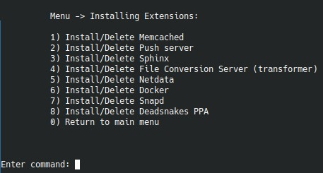

# Сервисы и утилиты



Эта страница покрывает пункты расширений, которые не требуют отдельного дерева сценариев.

## `Install/Delete Memcached`

Меню определяет наличие `memcached` по бинарнику и переключает состояние. После установки основной конфиг находится в:

```text
/etc/memcached.conf
```

Сокет в `/tmp/memcached.sock`

## `Install/Delete Push server`

При ошибке загрузки архива (включая TLS-таймаут) установка использует архив
из `vm_menu/ansible/playbooks/roles/bx_push_server/files/`. Перед установкой
проверяется SHA256; неверная контрольная сумма останавливает установку.

Конфиг в `/etc/default/push-server-multi`  
Получить "Код-подпись для взаимодействия с сервером:" `grep SECURITY_KEY= /etc/default/push-server-multi`  
Если push-server уже найден по одному из служебных файлов, меню предлагает удаление. При удалении дополнительно спрашивается:

- удалять ли `Redis` вместе с push-server.

Это удобно, если Redis используется еще кем-то кроме push-сервера.

## `Install/Delete Sphinx`

Состояние определяется по пакету `sphinxsearch`. Пункт просто устанавливает или удаляет полнотекстовый поиск.

## `Install/Delete OpenSearch`

Состояние определяется по пакету `opensearch`. При установке меню просит полный путь к Bitrix-сайту, устанавливает OpenSearch из официального APT-репозитория 3.x, генерирует учетные данные для `admin` и пользователя `bitrix_search`, настраивает модуль поиска Bitrix на `OpenSearch`.

После подтверждения `Do you really want to INSTALL OpenSearch? (Y/N)` меню задаёт вопрос `Install OpenSearch Dashboards? (Y/N)`. Ответ по умолчанию задаётся переменной `BS_INSTALL_OPENSEARCH_DASHBOARDS=N` в `.env.menu`.

В автотесте `make menu-extensions` выбор задаётся отдельной переменной `TEST_MENU_OPENSEARCH_DASHBOARDS` в `.env.test` (по умолчанию `Y`). Значение `N` отключает установку Dashboards и проверяет её отсутствие. Явное значение из окружения команды имеет приоритет над файлом; ответ меню и валидатор используют один и тот же выбор. Это тестовая настройка, она не меняет default интерактивного меню `BS_INSTALL_OPENSEARCH_DASHBOARDS`.

При ответе `Y` Dashboards устанавливается из [официального APT-репозитория](https://docs.opensearch.org/latest/install-and-configure/install-dashboards/debian/) с версией, совпадающей с OpenSearch. Интерфейс доступен по `http(s)://site.tld/opensearch/` на сайтах окружения. Для входа используйте `admin` и сгенерированный пароль OpenSearch. Сервис слушает только `127.0.0.1:5601`; nginx сохраняет префикс `/opensearch/` при проксировании.

Страница формы входа находится по `/opensearch/app/login`; автотест проверяет её доступность без авторизации и отдельно проверяет API с учётными данными `admin`. `/opensearch/auth/login` относится к API создания сессии, а не к HTML-странице: в [официальном Security plugin](https://github.com/opensearch-project/security-dashboards-plugin/blob/main/server/auth/types/basic/routes.ts) это POST-запрос с логином и паролем. Ошибка `401` при анонимном GET на этот API сама по себе не означает неисправность Dashboards.

Конфиг nginx находится в `/etc/${BS_SERVICE_NGINX_NAME}/custom_conf.d/section_listen_http_and_https/opensearch.conf`. Для связи Dashboards с OpenSearch создаётся отдельный пользователь `endebx_dashboards` со случайным паролем и обычной ролью с тем же именем. Права роли копируются через API из встроенной `kibana_server`: её зарезервированный mapping не позволяет прямое назначение через REST API в OpenSearch 3.9. Учётные данные служебного пользователя также сохраняются в `/root/opensearch.txt` и выводятся в `debug`.

Если OpenSearch уже установлен, пункт меню предложит удаление. Для добавления Dashboards без удаления OpenSearch запустите роль в режиме `INSTALL` от `root`:

```bash
cd /root/vm_menu
source bash_scripts/config.sh
if [ -f /root/.env.menu ]; then source /root/.env.menu; fi
ansible-playbook ansible/playbooks/install_or_delete_opensearch.yaml \
  -e opensearch_action=INSTALL -e opensearch_install_dashboards=true \
  -e "opensearch_bitrix_site_path='${BS_PATH_DEFAULT_SITE}'" \
  -e "opensearch_connection=${BS_OPENSEARCH_CONNECTION}" \
  -e "opensearch_bitrix_user=${BS_OPENSEARCH_BITRIX_USER}" \
  -e "opensearch_bitrix_index=${BS_OPENSEARCH_INDEX}" \
  -e "opensearch_version=${BS_OPENSEARCH_VERSION}" \
  -e "opensearch_bitrix_php_user=${BS_DEFAULT_USER_SERVER_SITES}" \
  -e "service_nginx_name=${BS_SERVICE_NGINX_NAME}"
```

Для другого сайта замените `BS_PATH_DEFAULT_SITE` на его полный путь. Сохранённые в `/root/opensearch.txt` пароли будут использованы повторно.

Учетные данные выводятся в конце выполнения роли и сохраняются в:

```text
/root/opensearch.txt
```

Роль пользователя Bitrix включает `cluster_composite_ops`: эти кластерные права нужны для пакетной индексации `/_bulk`, в том числе при обновлении пользователей Bitrix24. Права на индексы ограничены префиксом, заданным в `BS_OPENSEARCH_INDEX`.

Если OpenSearch уже установлен прежней версией роли и индексация завершается ошибкой `403` для `indices:data/write/bulk`, обновите стандартную роль `bitrix_search` от `root`:

```bash
source /root/opensearch.txt
curl -fksS -u "${OPENSEARCH_ADMIN_USER}:${OPENSEARCH_ADMIN_PASSWORD}" \
  -X PATCH "${OPENSEARCH_CONNECTION}/_plugins/_security/api/roles/bitrix_search" \
  -H 'Content-Type: application/json' \
  --data '[{"op":"add","path":"/cluster_permissions/-","value":"cluster_composite_ops"}]'
```

Команда добавляет права через [Patch Roles API](https://docs.opensearch.org/latest/security/api/roles/patch-roles/). Затем повторите действие в Bitrix.

При удалении меню переводит модуль поиска указанного сайта обратно на встроенный движок `bitrix`, удаляет пакет, репозиторий, ключ и файл с учетными данными. Dashboards, если установлен, удаляется вместе с OpenSearch, включая сервис, конфигурацию, репозиторий и nginx-конфиг. Дополнительного вопроса при удалении нет.

### Dashboards возвращает `503`, в журнале `cluster create-index blocked (api)`

Это блокировка создания индексов в OpenSearch (`cluster.blocks.create_index=true`), а не нехватка прав служебного пользователя. Dashboards не может создать `.kibana_1` при миграции сохранённых объектов. OpenSearch может автоматически включить блокировку, когда все узлы превышают порог заполнения диска `cluster.routing.allocation.disk.watermark.high` (по умолчанию `90%`); блокировку также можно задать вручную. См. [настройки управления кластером](https://docs.opensearch.org/latest/install-and-configure/configuring-opensearch/cluster-settings/).

Роль проверяет блокировку перед запуском Dashboards, учитывая приоритет `transient` над `persistent` и настройками по умолчанию. При блокировке она останавливается с настройками кластера и статистикой файловых систем данных. Если блокировка возникла во время миграции, проверка повторяется после таймаута API; для других ошибок запуска выводятся последние сообщения `journalctl`. Защита диска и блокировки автоматически не отключаются.

Проверьте место именно на файловой системе данных OpenSearch, обычно `/var/lib/opensearch`:

```bash
source /root/opensearch.txt
df -h /var/lib/opensearch
curl -fksS -u "${OPENSEARCH_ADMIN_USER}:${OPENSEARCH_ADMIN_PASSWORD}" \
  "${OPENSEARCH_CONNECTION}/_cluster/settings?include_defaults=true&flat_settings=true"
curl -fksS -u "${OPENSEARCH_ADMIN_USER}:${OPENSEARCH_ADMIN_PASSWORD}" \
  "${OPENSEARCH_CONNECTION}/_nodes/stats/fs?filter_path=nodes.*.name,nodes.*.fs.data"
```

Освободите место или увеличьте диск так, чтобы заполнение стало ниже действующего `high watermark`. При `cluster.blocks.create_index.auto_release=true` OpenSearch обычно снимает блокировку самостоятельно после обновления статистики диска (по умолчанию каждые `30s`). Увеличение таймаута роли или вход под `admin` не устраняют эту причину.

Только если место уже освобождено, блокировка осталась и не была установлена намеренно, сбросьте её в обоих уровнях настроек через [Cluster Settings API](https://docs.opensearch.org/latest/api-reference/cluster-api/cluster-settings/):

```bash
curl -fksS -u "${OPENSEARCH_ADMIN_USER}:${OPENSEARCH_ADMIN_PASSWORD}" \
  -X PUT "${OPENSEARCH_CONNECTION}/_cluster/settings" \
  -H 'Content-Type: application/json' \
  --data '{"persistent":{"cluster.blocks.create_index":null},"transient":{"cluster.blocks.create_index":null}}'
systemctl restart opensearch-dashboards
```

Если блокировка задана в `/etc/opensearch/opensearch.yml`, сброс через API её не отменит: сначала проверьте этот конфиг. Не отключайте `cluster.routing.allocation.disk.threshold_enabled` и не удаляйте `.kibana*` ради обхода ошибки. После восстановления повторите роль в режиме `INSTALL` командой выше, чтобы завершить настройку nginx.

## `Install/Delete File Conversion Server (transformer)`

При установке нужно указать:

- домен сайта;
- полный путь к сайту.

Пункт ориентирован на Bitrix-сценарий локального file conversion server и требует привязки к конкретному сайту. Только для лицензии Энтерпрайз. Меню самостоятельно произведёт все настройки битрикса для использования локального модуля.

## `Install/Delete Netdata`

Установка системы мониторинга [Netdata](https://www.netdata.cloud/)

Перед установкой обновляется APT-кэш и выбирается последняя общая доступная версия
`netdata`, `netdata-plugin-chartsd` и `netdata-plugin-pythond`. Все три пакета
устанавливаются с этой версией; если общей версии нет, установка завершается ошибкой.

- генерирует логин и пароль;
- создает htpasswd-файл для;
- после завершения показывает URL и выданные учетные данные.

## `Install/Delete Docker`

Установка свежей версии докера из официальных репозиториев. Роль меняет `log-driver` в `/etc/docker/daemon.json` c `json` на `local`, так как `json` очень сильно забивает место на диске.  
После установки в Docker-группу добавляются все локальные пользователи с UID `1000` и выше.

## `Install/Delete mydumper`

Установка или удаление `mydumper` из официального репозитория проекта. При удалении меню удаляет пакет, apt-репозиторий и ключ репозитория.
